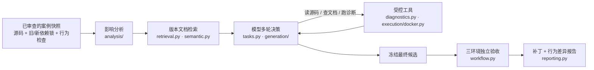

# Upgrade Workbench

[](https://github.com/PlainSightX/upgrade-workbench/actions/workflows/ci.yml)

[](LICENSE)

**依赖升级后测试通过，不等于行为没变。** 这是一个面向 Python 依赖迁移的 Agent 工作台：
模型调查受影响代码、查询对应版本的官方迁移说明并生成补丁；程序负责工具隔离、候选身份、
费用和中断恢复；最后在 Docker 中对「旧版 / 直接升级 / 修复候选」执行同一组行为检查，独立判定是否通过。
已验证范围主要是 Pydantic v1→v2 与 SQLAlchemy 1.x→2.0 的已登记案例。

## 一个例子：测试全绿，SQL 却被改坏

csvkit 的 `csvsql` 升级到 SQLAlchemy 2.0 后，字符串执行接口失效。把查询改成 `text(query)`
能通过原有的 4 项检查，却会把 SQL 中的 `:name` 冒号文本当成绑定参数。
补充跨连接可见性与冒号字面量检查后，正确修复是改用 `exec_driver_sql()`。

| 环境 | 同一组 6 项检查 |
| --- | --- |
| 原源码 + 旧依赖 | 6/6 |
| 原源码 + 新依赖（直接升级） | 0/6 |
| 修复候选 + 新依赖 | 6/6 |

不需要模型密钥即可复验：[csvsql 案例](docs/examples/csvsql/README.md)。
同一案例里也保留了一次模型新任务的失败（4/6，遗漏两项冒号检查），没有重跑到成功。

## 结果一览

| 对照 | 结论 | 说明 |
| --- | --- | --- |
| SQLAlchemy-Continuum 审计历史迁移（每臂 2 次） | 工作台与简单工具 Agent 都通过；工作台请求数 **−72.4%**、估算费用 **−45.4%** | [历史比较](docs/examples/comparison/README.md) |
| 三项历史迁移（每臂 2 次） | 两边都 6/6 通过；工作台估算费用 **+46.7%** | 同上，反向结果一并保留 |
| 版本文档检索（16 条 Pydantic 开发查询） | 目标章节进入前五：BM25 11/16 → BM25+向量 RRF **15/16** | [检索结果](docs/results/retrieval-pydantic-2026-09-16/README.md) |
| 未见仓库 4 个（Pydantic 1→2 两个、SQLAlchemy 1.4→2.0 两个，各运行一次） | **4 个中 4 个**通过独立验收；共 79 次请求、估算 $2.47 | [未见仓库汇总](docs/results/unseen-summary-2026-10-19/README.md) |

「简单工具 Agent」是同模型、可读源码和调用工具的基线，不是只发一次提示的裸模型。
前三行是已见开发案例上的小样本对照；最后一行是 4 个未见仓库各一次的运行，没有对照臂，
其中 3 个案例的较早修订在事后回放时也能通过同一组检查。都不代表未见仓库上的成功率。

## 快速开始

需要 Python 3.12 和 [uv](https://docs.astral.sh/uv/)；行为验证另需 Docker。

```powershell
uv sync --locked --extra service
uv run --no-sync pytest tests/unit          # 单测不调用模型、不运行第三方代码
uv run --no-sync upgrade-workbench inspect cases/csvkit-csvsql-sqlalchemy-2-a3
```

配置模型、预算账本和服务模式见 [安装与首次使用](docs/public-install.md)。

## 架构



| 模块 | 职责 |
| --- | --- |
| `analysis/` | AST 导入、别名、再导出与继承索引，定位受影响的调用点及未知边界 |
| `evidence.py` / `retrieval.py` / `semantic.py` | 按依赖版本过滤官方原文；BM25，可选 BGE-M3 向量 + RRF 融合与重排 |
| `generation/` | 构造请求、源码导航与工具动作；可选只读调查与知识复核角色 |
| `tasks.py` / `candidates.py` / `diagnostics.py` | 多轮状态推进、候选修订与审阅、诊断测量绑定到具体修订、停止规则 |
| `execution/` / `workflow.py` | Docker 隔离执行，三环境比较，通过 / 失败 / 无效测量分类 |
| `budget.py` | SQLite 事务化费用预留与核销 |
| `service/` | FastAPI 接口、PostgreSQL 作业与互斥、LangGraph interrupt/resume + PostgresSaver 检查点 |

## 关键设计

- **先落盘再发送。** 每次模型请求前先持久化身份并预留费用。远端可能已执行而本地没有完整回执时，
  任务进入 `outcome_unknown`，恢复时不盲目重发。
- **候选不能改自己的考卷。** 补丁只能改登记范围内的文件；最终验收在冻结候选后独立运行，
  结果不回传给模型继续修补。
- **第三方代码只在 Docker 中运行。** 案例固定镜像摘要和带哈希的依赖锁，宿主机不执行目标源码。
- **案例按内容寻址。** manifest、依赖锁、检查文件都有 SHA-256，结果绑定到确切的输入和实现身份。

## 局限

- 对照结果来自已登记的开发案例，每臂 2 次；未见仓库结果只有 4 个案例、各一次运行。都不是未见仓库的成功率，也没有统计显著性。
- 源码分析不是完整调用图，动态导入、包装和复杂绑定存在未知边界。
- 行为检查不穷尽所有业务行为：csvsql 原有 4 项检查就漏掉了冒号字面量。
- 费用是按登记单价的估算，不是供应商账单；没有测量人工节省时间，也没有生产用户。

## 文档

- [安装与首次使用](docs/public-install.md) · [开发与验证](CONTRIBUTING.md) · [测试与 CI 覆盖](docs/public-tests.md)
- 案例与对照：[csvsql](docs/examples/csvsql/README.md) · [历史比较](docs/examples/comparison/README.md) ·
  [版本语义自查](docs/semantic-risk-comparison.md) · [探针候选比较](docs/probe-comparisons.md) ·
  [有界输入生成](docs/probe-input-generation.md) · [可选值语义案例](docs/results/semantic-boundaries-a1/README.md)
- [第三方归因](THIRD_PARTY_NOTICES.md) · [公开文件清单](PUBLICATION.json)

自有代码采用 [MIT](LICENSE)，第三方材料保持各自许可。
